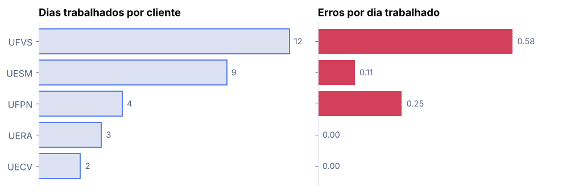

# Análise do diário em Python

Notebook que analisa os dias registrados no relatório de estágio com **pandas** e **matplotlib**.

> Os dados são **fictícios**, os mesmos da demo do relatório.

- [`analise_diario.ipynb`](analise_diario.ipynb): a análise, com gráficos e conclusões (o GitHub mostra o notebook já executado).
- [`diario.py`](diario.py): funções que carregam o diário, montam as tabelas e categorizam os erros.
- [`dados/diario_demo.json`](dados/diario_demo.json): os dias da demo, exportados em JSON.
- [`graficos/`](graficos): os gráficos gerados pelo notebook.

## Perguntas

1. Como o meu tempo se dividiu entre os tipos de atividade?
2. Em quais times e clientes eu mais trabalhei?
3. Onde apareceram mais erros, considerando quanto tempo passei em cada cliente?
4. Os erros mudaram ao longo das semanas?
5. Que tipo de erro eu mais encontro?



## Como rodar

```bash
cd analise
pip install -r requirements.txt
jupyter notebook analise_diario.ipynb
```
